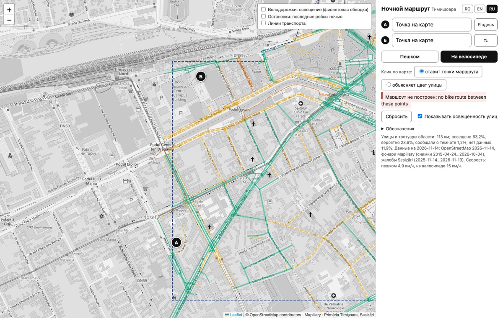

# Велосипед: часть маршрутов не строится (`404 no_route`)

- **Найдено:** 14.11.2026, около 18:10, на коммите `6ce905f` (сразу после `3010e2f` «cycling routes»).
- **Статус:** открыт. Код не менялся, все проверки — на копии графа в памяти.
- **Где:** `backend/routing.py`, `Network._build_graph("bike")`; на странице — `web/app.js`, вывод ошибки.

## Кратко

1. В режиме `mode=bike` **14–19% случайных пар точек** в области получают `404 no_route`, хотя обе точки привязались к велосети, а пешком маршрут между ними есть.
2. **Причина:** велосипедный граф направленный (односторонние улицы), а `_build_graph` оставляет самую большую **слабо** связную часть. Около 9% перекрёстков велосети не входят в самую большую **сильно** связную часть: туда можно въехать, но нельзя выехать, или наоборот. Если точка А или Б привязывается к такому отрезку, маршрута нет.
3. **Исправление проверено** на копии в памяти: оставлять для велосипеда только отрезки, у которых оба конца лежат в самой большой сильно связной части. Пар без маршрута становится 0; велосеть теряет 10,7 км из 127,6 км (8%).
4. **Сопутствующее:** текст ошибки не переведён, на русской и румынской странице видно английское «no bike route between these points».

Правила велосипеда при этом соблюдаются: на 600 парах ни один маршрут не прошёл по ступенькам, по тротуару без велознака или против движения по односторонней улице. Маршрут считается за 2–100 мс.

## Как воспроизвести

Сервер: `./scripts/mac/lightmap.sh api`.

```bash
curl "http://localhost:8001/api/route?from=45.74315,21.21053&to=45.75057,21.21208&mode=bike"
# HTTP 404 {"detail":{"code":"no_route","message":"no bike route between these points"}}

curl "http://localhost:8001/api/route?from=45.74315,21.21053&to=45.75057,21.21208&mode=walk"
# HTTP 200: 17,6 мин, 1 428 м
```

На странице: http://localhost:8001/?lang=ru#a=45.74315,21.21053&b=45.75057,21.21208&m=bike



| | Ожидалось | Получилось |
|---|---|---|
| API | маршрут, или 422 `outside_coverage`, если точка далеко от велосети | 404 `no_route` |
| Страница | маршрут или понятное сообщение на языке страницы | «Маршрут не построен: no bike route between these points» |

## Масштаб

Метод: 600 случайных пар точек, равномерно в прямоугольнике, зерно 11. Пары, где точка дальше 300 м от велосети, не считаются: для них правильный ответ — `outside_coverage`.

| Где брали точки | Пар, где обе точки привязались | Без маршрута сейчас | Без маршрута после исправления |
|---|---:|---:|---:|
| Рамка области `[21.2103, 45.7405, 21.244, 45.7632]` | 476 | **67 (14,1%)** | 0 из 455 |
| Ядро `[21.21, 45.74, 21.245, 45.76]` | 521 | **100 (19,2%)** | 0 из 505 |

После исправления привязываются чуть меньше пар, потому что часть отрезков уходит из велосети: расстояние от точки до велосети по медиане 19 → 21 м, 90-й процентиль 101 → 138 м.

Проверить у себя (из корня репозитория):

```bash
.venv/bin/python - <<'EOF'
import random
from backend.routing import Network
net = Network.load("data/out/city/segments.geojson.gz")
w, s, e, n = net.meta["bounds_wsen"]
rnd = random.Random(11); both = fail = 0
for _ in range(600):
    a = (rnd.uniform(s, n), rnd.uniform(w, e)); b = (rnd.uniform(s, n), rnd.uniform(w, e))
    A, B = net.snap(*a, mode="bike"), net.snap(*b, mode="bike")
    if A and B:
        both += 1
        fail += net.plan(A, B, mode="bike") is None
print(f"{fail} of {both} pairs without a bike route")   # сейчас: 67 of 476; после исправления: 0
EOF
```

## Причина

В `Network._build_graph("bike")`:

- связная часть ищется по неориентированным связям (список `und`), так что для пешехода всё верно;
- но для велосипеда `adj` направленный: у одностороннего отрезка есть только ребро `a → b` (`both[i] = False`);
- поэтому в «главную часть» попадают отрезки, из которых по направлению движения нельзя добраться до остальной сети (или в которые нельзя попасть);
- `snap(mode="bike")` может привязать к ним точку, A* не находит пути, `plan()` возвращает `None`, API отвечает 404.

Цифры по велосипедному графу области:

| Что | Значение |
|---|---|
| Перекрёстков в велосети | 2 423 |
| В самой большой сильно связной части | 2 197 (90,7%) |
| Других сильно связных частей | 148 (мелкие тупики и петли) |
| Отрезков велосети с концом вне неё | 238 (10,7 км из 127,6 км) |
| По типу дороги | service 70, residential 65, footway 49, tertiary 23, secondary 7, path 7 |
| Улицы с такими отрезками | Splaiul Nicolae Titulescu, Strada Socrate, Bulevardul Republicii, Strada Ștefan Covaci, Bulevardul 16 Decembrie 1989, Bulevardul Take Ionescu |

Типичные случаи:

1. **Односторонние улицы, обрезанные границей области.** Въезд внутри области есть, а выезд — за границей, его нет в графе.
2. **Дворовые проезды (`service`),** куда попадаешь только по односторонней улице.
3. **Односторонние велополосы на тротуарах** (своя на каждой стороне улицы), которые обрываются или не соединяются с остальной сетью в нужном направлении.

Примеры пар без маршрута:

| Откуда → куда | А привязалась к | Б привязалась к |
|---|---|---|
| `45.74315,21.21053` → `45.75057,21.21208` | Strada Iancu Văcărescu, footway, односторонний, в главной части | проезд без названия, service, **вне главной части** |
| `45.74380,21.21847` → `45.74060,21.22624` | Strada Alexandru Odobescu, residential, односторонний, в главной части | проезд без названия, service, **вне главной части** |
| `45.75916,21.23966` → `45.74001,21.21734` | Bulevardul Take Ionescu, footway, односторонний, **вне главной части** | проезд без названия, service, в главной части |
| `45.74146,21.23203` → `45.75557,21.21944` | Strada 1 Decembrie 1918, residential, односторонний, в главной части | Strada Coriolan Brediceanu, tertiary, односторонний, **вне главной части** |

## Как исправить

### Вариант 1 (рекомендую, проверен): только самая большая сильно связная часть

В `_build_graph`, для `mode == "bike"`, после построения направленного `adj`:

```python
if mode == "bike":
    main = largest_scc(adj)
    routable = [ok and self.a[i] in main and self.b[i] in main for i, ok in enumerate(routable)]
    adj = [[(v, s) for v, s in nbrs if routable[s]] for nbrs in adj]
    # snap_idx и snap_tree строить уже по новому routable
```

Для пешехода ничего не меняется: его граф ненаправленный, слабая и сильная связность совпадают.

Функция без зависимостей (на сервер по плану деплоя `networkx` не ставится). Проверена: на велосипедном графе области даёт ту же часть, что `networkx.strongly_connected_components` (2 197 узлов), и совпадает с ним на 300 случайных направленных графах.

```python
def largest_scc(adj):
    """Nodes of the largest strongly connected component; adj[u] = [(v, seg), ...]. Iterative Kosaraju, no deps."""
    n = len(adj)
    radj = [[] for _ in range(n)]
    for u, nbrs in enumerate(adj):
        for v, _ in nbrs:
            radj[v].append(u)
    order, seen = [], [False] * n
    for s in range(n):
        if seen[s] or not adj[s]:
            continue
        seen[s] = True
        stack = [(s, iter(adj[s]))]
        while stack:
            u, it = stack[-1]
            for v, _ in it:
                if not seen[v]:
                    seen[v] = True
                    stack.append((v, iter(adj[v])))
                    break
            else:
                stack.pop()
                order.append(u)
    comp, best = [-1] * n, set()
    for s in reversed(order):
        if comp[s] != -1:
            continue
        members, stack = [], [s]
        comp[s] = s
        while stack:
            u = stack.pop()
            members.append(u)
            for v in radj[u]:
                if comp[v] == -1:
                    comp[v] = s
                    stack.append(v)
        if len(members) > len(best):
            best = set(members)
    return best
```

Минус: 10,7 км велосети (8%) перестают использоваться, точки рядом с ними привязываются чуть дальше.

### Вариант 2 (точнее, больше работы): «провести велосипед» против движения

Разрешить ехать по одностороннему отрезку против движения, но с ценой и временем пешехода, как `dismount`: человек спешивается и ведёт велосипед по тротуару. Тогда граф становится сильно связным везде, где можно пройти пешком, и километры не теряются. Нужно отдельно пометить такие куски в ответе и на карте («ведите велосипед»), иначе маршрут будет выглядеть как езда против движения.

Можно сделать сначала вариант 1, а вариант 2 — если останется время.

### Тест

Добавить в `backend/tests/test_bike.py` маленький граф с односторонним тупиком (въезд есть, выезда нет):

- точка у тупика привязывается не к нему, а к ближайшему отрезку главной части;
- маршрут между любыми двумя привязанными точками существует.

## Сопутствующее: текст ошибки не переведён

Сейчас страница показывает `detail.message` сервера как есть, по-английски. Лучше выбирать текст по `detail.code` из `web/i18n.js`. Коды: `no_route`, `outside_coverage`, `mode_not_supported`, `bad_point`. Например, для `no_route` на велосипеде:

| Язык | Текст |
|---|---|
| RO | Nu am găsit un traseu cu bicicleta între aceste puncte. Încercați pe jos sau mutați unul dintre puncte. |
| EN | No bike route between these points. Try on foot or move one of the points. |
| RU | На велосипеде маршрут между этими точками не найден. Попробуйте пешком или передвиньте одну из точек. |

Румынский текст стоит показать носителю языка.

## Как проверить исправление

1. `./scripts/mac/lightmap.sh test` — все тесты проходят, включая новый тест на тупик.
2. Пример из «Как воспроизвести» в `mode=bike` отвечает 200.
3. Скрипт из раздела «Масштаб» печатает `0 of … pairs without a bike route`.
4. На странице с `m=bike` ошибка, если появляется, показывается на языке страницы.
