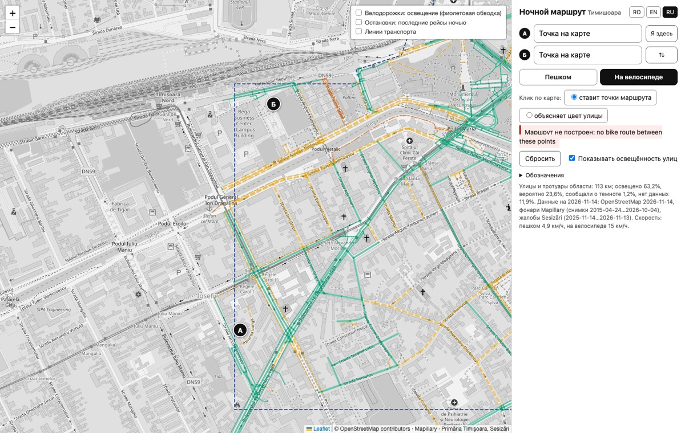

# Велосипед: частина маршрутів не будується (`404 no_route`)

- **Знайдено:** 14.11.2026, близько 18:10, на коміті `6ce905f` (одразу після `3010e2f` «cycling routes»).
- **Статус:** відкрито. Код не змінювався, усі перевірки зроблено на копії графа в пам'яті.
- **Де:** `backend/routing.py`, `Network._build_graph("bike")`; на сторінці — `web/app.js`, виведення помилки.

## Коротко

1. У режимі `mode=bike` **14–19% випадкових пар точок** в області отримують `404 no_route`, хоча обидві точки прив'язалися до веломережі, а пішки маршрут між ними є.
2. **Причина:** велосипедний граф орієнтований (односторонні вулиці), а `_build_graph` залишає найбільшу **слабко** зв'язну частину. Близько 9% перехресть веломережі не входять до найбільшої **сильно** зв'язної частини: туди можна заїхати, але не можна виїхати, або навпаки. Якщо точка А чи Б прив'язується до такого відрізка, маршруту немає.
3. **Виправлення перевірено** на копії в пам'яті: залишати для велосипеда лише відрізки, обидва кінці яких лежать у найбільшій сильно зв'язній частині. Пар без маршруту стає 0; веломережа втрачає 10,7 км із 127,6 км (8%).
4. **Супутнє:** текст помилки не перекладено, на російській і румунській сторінці видно англійське «no bike route between these points».

При цьому правил для велосипеда дотримано: на 600 парах жоден маршрут не пройшов сходами, тротуаром без велознака чи проти руху односторонньою вулицею. Маршрут обчислюється за 2–100 мс.

## Як відтворити

Сервер:

- Mac: `./scripts/mac/lightmap.sh api`
- Windows (Git Bash): `.venv/Scripts/python -m uvicorn backend.app:app --port 8001`

```bash
curl "http://localhost:8001/api/route?from=45.74315,21.21053&to=45.75057,21.21208&mode=bike"
# HTTP 404 {"detail":{"code":"no_route","message":"no bike route between these points"}}

curl "http://localhost:8001/api/route?from=45.74315,21.21053&to=45.75057,21.21208&mode=walk"
# HTTP 200: 17,6 хв, 1 428 м
```

На сторінці: http://localhost:8001/?lang=ru#a=45.74315,21.21053&b=45.75057,21.21208&m=bike



| | Очікувалося | Фактично |
|---|---|---|
| API | маршрут або 422 `outside_coverage`, якщо точка далеко від веломережі | 404 `no_route` |
| Сторінка | маршрут або зрозуміле повідомлення мовою сторінки | «Маршрут не построен: no bike route between these points» |

## Масштаб

Метод: 600 випадкових пар точок, рівномірно в прямокутнику, зерно генератора 11. Пари, де точка далі ніж 300 м від веломережі, не враховуються: для них правильна відповідь — `outside_coverage`.

| Де брали точки | Пар, де обидві точки прив'язалися | Без маршруту зараз | Без маршруту після виправлення |
|---|---:|---:|---:|
| Рамка області `[21.2103, 45.7405, 21.244, 45.7632]` | 476 | **67 (14,1%)** | 0 із 455 |
| Ядро `[21.21, 45.74, 21.245, 45.76]` | 521 | **100 (19,2%)** | 0 із 505 |

Після виправлення прив'язується трохи менше пар, бо частина відрізків виходить із веломережі: відстань від точки до веломережі за медіаною 19 → 21 м, 90-й процентиль 101 → 138 м.

Перевірити у себе (з кореня репозиторію; на Windows замість `.venv/bin/python` — `.venv/Scripts/python`):

```bash
.venv/bin/python - <<'EOF'
import random
from backend.routing import Network
net = Network.load("data/out/city/segments.geojson.gz")
w, s, e, n = net.meta["bounds_wsen"]
rnd = random.Random(11); both = fail = 0
for _ in range(600):
    a = (rnd.uniform(s, n), rnd.uniform(w, e)); b = (rnd.uniform(s, n), rnd.uniform(w, e))
    A, B = net.snap(*a, mode="bike"), net.snap(*b, mode="bike")
    if A and B:
        both += 1
        fail += net.plan(A, B, mode="bike") is None
print(f"{fail} of {both} pairs without a bike route")   # зараз: 67 of 476; після виправлення: 0
EOF
```

## Причина

У `Network._build_graph("bike")`:

- зв'язна частина шукається за неорієнтованими зв'язками (список `und`), тож для пішохода все правильно;
- але для велосипеда `adj` орієнтований: в одностороннього відрізка є лише ребро `a → b` (`both[i] = False`);
- тому до «головної частини» потрапляють відрізки, з яких за напрямком руху не можна дістатися решти мережі (або в які не можна потрапити);
- `snap(mode="bike")` може прив'язати до них точку, A* не знаходить шляху, `plan()` повертає `None`, API відповідає 404.

Цифри для велосипедного графа області:

| Що | Значення |
|---|---|
| Перехресть у веломережі | 2 423 |
| У найбільшій сильно зв'язній частині | 2 197 (90,7%) |
| Інших сильно зв'язних частин | 148 (дрібні тупики й петлі) |
| Відрізків веломережі з кінцем поза нею | 238 (10,7 км із 127,6 км) |
| За типом дороги | service 70, residential 65, footway 49, tertiary 23, secondary 7, path 7 |
| Вулиці з такими відрізками | Splaiul Nicolae Titulescu, Strada Socrate, Bulevardul Republicii, Strada Ștefan Covaci, Bulevardul 16 Decembrie 1989, Bulevardul Take Ionescu |

Типові випадки:

1. **Односторонні вулиці, обрізані межею області.** В'їзд усередині області є, а виїзд — за межею, його немає в графі.
2. **Дворові проїзди (`service`),** куди потрапляєш лише односторонньою вулицею.
3. **Односторонні велосмуги на тротуарах** (своя з кожного боку вулиці), які обриваються або не з'єднуються з рештою мережі в потрібному напрямку.

Приклади пар без маршруту:

| Звідки → куди | А прив'язалася до | Б прив'язалася до |
|---|---|---|
| `45.74315,21.21053` → `45.75057,21.21208` | Strada Iancu Văcărescu, footway, односторонній, у головній частині | проїзд без назви, service, **поза головною частиною** |
| `45.74380,21.21847` → `45.74060,21.22624` | Strada Alexandru Odobescu, residential, односторонній, у головній частині | проїзд без назви, service, **поза головною частиною** |
| `45.75916,21.23966` → `45.74001,21.21734` | Bulevardul Take Ionescu, footway, односторонній, **поза головною частиною** | проїзд без назви, service, у головній частині |
| `45.74146,21.23203` → `45.75557,21.21944` | Strada 1 Decembrie 1918, residential, односторонній, у головній частині | Strada Coriolan Brediceanu, tertiary, односторонній, **поза головною частиною** |

## Як виправити

### Варіант 1 (рекомендую, перевірено): лише найбільша сильно зв'язна частина

У `_build_graph`, для `mode == "bike"`, після побудови орієнтованого `adj`:

```python
if mode == "bike":
    main = largest_scc(adj)
    routable = [ok and self.a[i] in main and self.b[i] in main for i, ok in enumerate(routable)]
    adj = [[(v, s) for v, s in nbrs if routable[s]] for nbrs in adj]
    # snap_idx і snap_tree будувати вже за новим routable
```

Для пішохода нічого не змінюється: його граф неорієнтований, слабка й сильна зв'язність збігаються.

Функція без залежностей (на сервер за планом деплою `networkx` не встановлюється). Перевірена: на велосипедному графі області дає ту саму частину, що й `networkx.strongly_connected_components` (2 197 вузлів), і збігається з ним на 300 випадкових орієнтованих графах.

```python
def largest_scc(adj):
    """Nodes of the largest strongly connected component; adj[u] = [(v, seg), ...]. Iterative Kosaraju, no deps."""
    n = len(adj)
    radj = [[] for _ in range(n)]
    for u, nbrs in enumerate(adj):
        for v, _ in nbrs:
            radj[v].append(u)
    order, seen = [], [False] * n
    for s in range(n):
        if seen[s] or not adj[s]:
            continue
        seen[s] = True
        stack = [(s, iter(adj[s]))]
        while stack:
            u, it = stack[-1]
            for v, _ in it:
                if not seen[v]:
                    seen[v] = True
                    stack.append((v, iter(adj[v])))
                    break
            else:
                stack.pop()
                order.append(u)
    comp, best = [-1] * n, set()
    for s in reversed(order):
        if comp[s] != -1:
            continue
        members, stack = [], [s]
        comp[s] = s
        while stack:
            u = stack.pop()
            members.append(u)
            for v in radj[u]:
                if comp[v] == -1:
                    comp[v] = s
                    stack.append(v)
        if len(members) > len(best):
            best = set(members)
    return best
```

Мінус: 10,7 км веломережі (8%) перестають використовуватися, точки поруч із ними прив'язуються трохи далі.

### Варіант 2 (точніше, більше роботи): «провести велосипед» проти руху

Дозволити проходити односторонній відрізок проти руху, але з ціною та часом пішохода, як `dismount`: людина спішується й веде велосипед тротуаром. Тоді граф стає сильно зв'язним скрізь, де можна пройти пішки, і кілометри не втрачаються. Такі шматки треба окремо позначити у відповіді та на мапі («ведіть велосипед»), інакше маршрут виглядатиме як їзда проти руху.

Можна спершу зробити варіант 1, а варіант 2 — якщо залишиться час.

### Тест

Додати до `backend/tests/test_bike.py` маленький граф з одностороннім тупиком (в'їзд є, виїзду немає):

- точка біля тупика прив'язується не до нього, а до найближчого відрізка головної частини;
- маршрут між будь-якими двома прив'язаними точками існує.

## Супутнє: текст помилки не перекладено

Зараз сторінка показує `detail.message` сервера як є, англійською. Краще обирати текст за `detail.code` з `web/i18n.js`. Коди: `no_route`, `outside_coverage`, `mode_not_supported`, `bad_point`. Наприклад, для `no_route` на велосипеді (сторінка має три мови):

| Мова | Текст |
|---|---|
| RO | Nu am găsit un traseu cu bicicleta între aceste puncte. Încercați pe jos sau mutați unul dintre puncte. |
| EN | No bike route between these points. Try on foot or move one of the points. |
| RU | На велосипеде маршрут между этими точками не найден. Попробуйте пешком или передвиньте одну из точек. |

Румунський текст варто показати носієві мови.

## Як перевірити виправлення

1. Тести проходять, зокрема новий тест на тупик:
   - Mac: `./scripts/mac/lightmap.sh test`
   - Windows (Git Bash): `.venv/Scripts/python -m pytest backend/tests -q`
2. Приклад із розділу «Як відтворити» в `mode=bike` відповідає 200.
3. Скрипт із розділу «Масштаб» друкує `0 of … pairs without a bike route`.
4. На сторінці з `m=bike` помилка, якщо з'являється, показується мовою сторінки.
