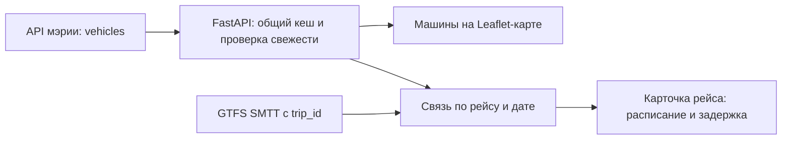

# Live-обновления транспорта: проверка 14.11.2026

**Вывод: можно подключить к Bloom.** Публичный JSON API мэрии уже отдаёт движущиеся машины, время GPS-наблюдения, идентификатор рейса и, для части машин, задержку. Переписывать FastAPI и Leaflet не требуется.

> **Обновление 14.11, 23:15: подключено.** `backend/live.py` и `GET /api/transit/live` реализуют пункты 1–4 и первую часть 5 плана ниже: общий кеш (15 с, пауза после ошибок, `Retry-After`), порог свежести 90 с, задержка вне −10…+30 мин не используется, связь по `trip_id` и `stopSequence`. Добавлено то, чего не было в плане: в GTFS SMTT есть `block_id`, и за 10–20 минут до отправления машина нужного рейса обычно ещё едет предыдущим рейсом своего блока. Тогда показываем её и оцениваем опоздание как `max(0, конец предыдущего рейса + его задержка − начало нашего)`. Наблюдение в 22:58–23:00: у одного и того же рейса линии 16 два разных `id` машины с задержкой 759 и −67 с в соседних ответах. Данные шумные, поэтому на странице это всегда «оценка», а позиция машины видна. Пересчёт выбора рейса по живым задержкам (пункт 5) не сделан.

## Что проверено прямыми запросами

Источник: [GET /api/mobile/transit/vehicles](https://cont.primariatm.ro/api/mobile/transit/vehicles). Два запроса без ключа, авторизации и cookies, с User-Agent команды; оба вернули `200 application/json`. В заголовках: `Access-Control-Allow-Origin: *`, `Cache-Control: public`. Это наблюдаемое поведение, не гарантия SLA или отсутствия будущих ограничений.

| Проверка | Первый ответ | Второй ответ |
|---|---:|---:|
| HTTP Date, Europe/Bucharest | 14.11.2026 21:34:24 | 14.11.2026 21:35:36 |
| Машин во всём ответе | 67 | 65 |
| Различных маршрутов | 34 | 34 |
| Машин внутри текущей области карты | 20 | 15 |
| Машин с непустым `delaySec` | 54 | 54 |
| Возраст GPS: минимум / медиана / максимум | 11 / 17 / 68 с | 9 / 13 / 93 с |
| `realtimeAgeSec`, как сообщил API | 4 | 1 |
| `refreshInSec`, как сообщил API | 3 | 5,7 |

Между ответами прошло 72 секунды. Из 65 машин, присутствующих в обоих ответах, у 64 вырос `updatedAt`, у 54 изменились координаты. Следовательно, источник действительно обновляется. Два снимка не доказывают постоянный интервал обновления или полноту покрытия парка.

Во втором ответе одна GPS-точка уже старше 90 секунд, хотя `realtimeAgeSec` равен 1. Поэтому свежесть каждого маркера надо считать по его `updatedAt`. Повторное получение той же точки не делает её свежей.

Наблюдаемые поля машины:

| Поля | Применение |
|---|---|
| `id`, `lat`, `lon`, `bearing`, `speed` | маркер машины и направление; единицу скорости нужно подтвердить перед показом |
| `routeId`, `tripId`, `directionId`, `headsign` | связь с линией, рейсом и направлением GTFS |
| `stopId`, `stopSequence`, `status` | положение относительно остановок; в ответах есть `STOPPED_AT`, `IN_TRANSIT_TO` |
| `delaySec` | сообщённая задержка в секундах; встречается `null`, это не нулевая задержка |
| `updatedAt` | время GPS-наблюдения, Unix seconds |
| `wheelchair` | признак машины; не доказывает доступность всего пути и остановок |

В проверенном ответе нет массива прогнозов прибытия на каждую следующую остановку, явных отмен рейсов или пропуска остановок. `delaySec` позволяет показать сообщённую задержку. «Расписание + текущая задержка» может стать приблизительным прогнозом, но требует проверки смысла задержки и сопоставления рейса; нельзя выдавать его за точный ETA.

**Сопоставление с исходным GTFS выполнено:** в обоих снимках у всех машин `tripId`, соответствующие `routeId`, `directionId` и пара `stopSequence → stopId` совпали с v4.31; все эти рейсы действуют 14 ноября. Те же ID есть в v4.32, но в нём ни один из этих рейсов не активен 14 ноября. Выбор фида по дате обслуживания обязателен даже при полном совпадении ID.

**Задержку нельзя применять без проверки:** диапазон `delaySec` в двух снимках от −472 до 6496 секунд. У двух трамваев на первой остановке (`STOPPED_AT`) задержка около 93 и 108 минут при свежем GPS. Это наблюдаемые значения, а не подтверждённое опоздание к нашей остановке. Для MVP аномальные величины не использовать в ETA, показывать состояние «прогноз недоступен»; правила проверки и допустимый диапазон согласовать после наблюдений. Отрицательные значения и `null` обрабатывать отдельно.

Во втором снимке 63 из 65 машин идут по линиям, известным локальному расписанию, но только у 33 текущая остановка входит в обрезанный GTFS области. Маркеры фильтровать по координатам, а не наличию текущей остановки в локальном расписании.

## Что дал веб-поиск

- [STPT, 19.02.2026](https://stpt.ro/aplicatia-tranzy-nu-mai-este-activa-in-timisoara/): Tranzy больше не работает в Тимишоаре. В той же публикации STPT рекомендует Live.STPT, Csuki, Transit и Google Maps. Рекомендации использовать старый Tranzy API для этого города устарели.
- [SMTT: Google Maps Transit Realtime](https://smtt.ro/google-maps/): оператор описывает актуализируемое время прибытия и позиции машин. Это подтверждает наличие real-time данных, но не раскрывает публичный GTFS-RT URL.
- [Live.STPT](https://live.stpt.ro/) показывает транспорт, однако его [условия, §6](https://live.stpt.ro/termeni.php) ограничивают автоматическое извлечение без разрешения. Для нашего MVP есть более прямой проверенный источник — API мэрии. Условия Live.STPT не следует автоматически переносить на другой домен и его API.
- [Спецификация GTFS Realtime](https://gtfs.org/documentation/realtime/reference/) различает VehiclePosition и TripUpdate. Наличие координат машины само по себе не подтверждает полноценные прогнозы по остановкам.

Публичный поддерживаемый бинарный GTFS-RT URL в ходе поиска не подтверждён. Для MVP он не обязателен: городской JSON уже содержит нужные для маркеров поля. Публичные квоты и долгосрочные условия работы городского endpoint не проверены; следуем уже зафиксированным в проекте требованиям UniHack: GET, User-Agent команды, серверный кеш.

## Что уже есть в проекте

- `scripts/transit/logger.py` уже читает этот endpoint и записывает наблюдения в CSV, исключая повторы по `id`/`updatedAt`. Он **не подключён** к веб-странице или планировщику. Скрипт использует `fcntl` и рассчитан на macOS/Linux; для Windows нужна адаптация блокировки файла.
- `backend/app.py` загружает `transit.json.gz` при запуске; `/api/route?mode=transit` использует статическое расписание из `backend/transit.py`.
- `web/app.js` не обновляет маршрут по таймеру; `web/i18n.js` честно пишет, что live-задержки не учтены.
- `backend/build_transit.py` читает исходные `trip_id` и `stop_sequence`, но выбрасывает их при сохранении: остаются `[pattern_index, departure_times]`. Для связи с live их нужно сохранить, вместе с датой обслуживания и версией GTFS. Не сопоставлять машины только по номеру линии.
- В готовой сборке есть расписание только на **14–16 ноября 2026**: v4.31 для 14–15 ноября и v4.32 для 16 ноября. Перед демо пересобрать; далее регулярно обновлять диапазон. День вне диапазона — «нет расписания», а не доказательство отсутствия транспорта.

## Предлагаемый MVP



1. Добавить `backend/transit_realtime.py`: единый кеш для пользователей, таймаут, повтор после ошибок с увеличением интервала; предполагаемый начальный интервал **15 секунд**, с учётом `refreshInSec` и HTTP 429/Retry-After. Это настройка проекта, не заявленная квота провайдера. При нескольких процессах нужен общий кеш или один сборщик.
2. Добавить `GET /api/transit/vehicles` и отдельный слой Leaflet: номер линии, направление, время наблюдения. Фильтровать по области карты или выбранному маршруту. UI обновлять только когда слой видим; останавливать polling скрытой вкладки.
3. Для MVP предложить порог устаревания **90 секунд** по `updatedAt` (настройка, требует наблюдений). Различать «live», «данные устарели» и «нет данных». При ошибке не превращать старый снимок в свежий и не объявлять все рейсы отменёнными.
4. Сохранить идентификаторы рейсов и исходные номера остановок в сборке GTFS; связать точку с рейсом нужного service day. Учитывать направление, смену версии фида и времена `24:xx`, использовать Europe/Bucharest.
5. Сначала показывать задержку отдельно рядом с расписанием. Если использовать оценку задержки в маршрутизации — учитывать её **до выбора рейса**: иначе можно предложить уже недостижимую посадку или пропустить опаздывающий рейс, который ещё можно поймать. Не применять нынешние live-данные к маршруту на завтра. Пропавшая из ответа машина не равна отменённому рейсу.
6. Проверить на тестовых ответах свежие/старые точки, `null` и отрицательную задержку, несовпавший рейс, ошибки/таймаут, полночь и доступность посадки после сдвига времени. Затем проверить выбранную остановку в реальности.

Приоритет для хакатона: **живые машины + сообщённая задержка + видимая свежесть**, затем пересчёт поездки с задержками. Полноценный прогноз ETA и автоматические отмены требуют дополнительных данных и проверки.

## Как повторить проверку

Один GET из PowerShell, без запуска постоянного логгера:

```powershell
curl.exe --max-time 20 -H "User-Agent: Bloom-UniHack-2026" "https://cont.primariatm.ro/api/mobile/transit/vehicles"
```

Повторить не раньше чем через 15 секунд; сравнить `updatedAt` и координаты по `id`. Проверять возраст наблюдения, а не только HTTP 200. Веб-инструмент чтения страниц этот URL не открыл, но прямой HTTPS-запрос с данного компьютера сработал. Доступ с будущего хостинга надо проверить отдельно.

Локальные снимки проверки сохранены в `data/transit/research-2026-11-14/vehicles-213424.json` и `vehicles-213536.json`; папка транспортных наблюдений исключена из git. Исходные GTFS — в `unihack-data/gtfs/` у команды. При переносе только репозитория сырых снимков не будет.
